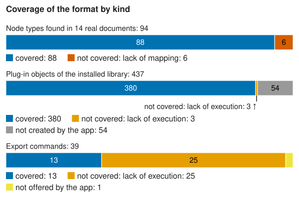

# vwx rosetta

Rosetta is a reference corpus for the Vectorworks `.vwx` file format: small, synthetic Vectorworks documents, each
paired with what Vectorworks itself exported from it. It tests a reader of `.vwx` files; running the tests needs no
copy of Vectorworks.

We generated every document by script in Vectorworks 2027 (32.1.0, build 885363), from a recipe that names its
objects and parameters. Each case is named after the feature it tests. PROVENANCE.md tells how we made Rosetta and
what we removed before publishing it.

## A case

A case is one small document that isolates one object family, representation or behaviour, named
`family.object.variant`:
- `annotation.dimension.angular`: an angular dimension;
- `building.wall.with_door_window`: a wall with a door and a window inserted;
- `ix.*`: pairwise interaction cases from a covering array (`ledger/covering/`), each combining several factors.

The families are annotation, building, container, control, document, entertainment, landscape, nurbs, option,
planar, plugin, resource, solid and spatial. The geometry is asymmetric, so swapped axes, mirrored frames and wrong
origins show. docs/DESIGN.md gives how we chose the cases and the limits of what they show.

## Layout

| Path | What |
|---|---|
| `sources/<case>.vwx` | the generated source document of each case; `sources/SOURCES.tsv` lists each with its sha256 |
| `files/<case>/` | what Vectorworks exported from it: DXF and DWG in several profiles, PNG, PDF, OBJ, STL, FBX, glTF, 3DS, Parasolid, SAT, IFC, and the document saved back to earlier versions (`<case>.v2023.vwx` and others) |
| `ledger/manifest.json` | every source/reference pair, with hashes: the contract a consumer reads |
| `ledger/intent.json` | what each case contains: its recipe, script, objects and parameters |
| `ledger/*.tsv`, `ledger/covering/` | the tables the manifest is built from: required pairs, negatives, companions, coverage, export settings |
| `driver/inventory/` | the scripts and recipes that generated the cases (see docs/GENERATING.md) |
| `driver/batch.py`, `driver/batch/`, `driver/ui/`, `driver/scripted/`, `driver/native/`, `driver/tests/` | the driver that ran them: batches, the user-interface driver, the scripted routes, its CLI's Zig source, its tests (docs/REPRODUCING.md; not re-validated) |
| `driver/MANIFEST.md` | the fields of manifest.json and intent.json |
| `driver/EXPORT-VARIANCE.md` | what differs between two exports of the same source |
| `extras/` | recorded negatives and leftovers, each with its reason |
| `docs/` | DESIGN.md (how Rosetta was designed), GENERATING.md (how it was generated), REPRODUCING.md (how to run the driver), WHY.md (why it was built this way, and what changed on the way), coverage.svg (the chart in Coverage, written by `tools/coverage.py`) |
| `tools/index.py` | writes INDEX.md from the ledger |

## Profiles

A profile is one export setting. The pairs use these:
- DXF: `dxf.all-content`, `dxf.visible-only`, `dxf.top-plan`, `dxf.all-content.design-layers`,
  `dxf.all-content.acis-off`;
- DWG: `dwg.all-content`, `dwg.visible-only`;
- images and drawings: `png.top-plan`, `pdf.vector`, and `svg.vector`, whose pairs are all negative because this
  edition has no SVG export;
- meshes and solids: `obj.mesh`, `gltf.mesh`, `fbx.mesh`, `3ds.mesh`, `3ds.mesh.all-layers`, `stl.binary.high-all`,
  `parasolid.solids`, `sat.solids`;
- other: `ifc.semantic`, `vwx.2022` to `vwx.2026` (the document saved in an earlier file version), and
  `csv.worksheet` and `xlsx.worksheet`, which are negative because they export from a worksheet window and the
  cases had none.

The profile files, with their option values, are in `driver/inventory/pack-skeleton/profiles/`.

## Reading the manifest

A reader test takes a pair from `ledger/manifest.json`, reads the source, and compares its own result with the
reference. Each pair names a case, a profile and a format, the source and the reference with their sha256, and its
state: `artifact`, or `negative` when the export wrote no file, or a file without what the case tests.
`driver/MANIFEST.md` gives every field (schema `rosetta-manifest/1`). The manifest has 1555 pairs over 141 cases; 40
more case folders under `files/` hold later cases that are not yet in it, with their sources under `sources/`.

We compared two pairs of exports of one source (`driver/EXPORT-VARIANCE.md`): they differ in the export dates, the
GUIDs and the ACIS save time, and keep the same handles. So a test compares structure and content.

INDEX.md lists every case with its profiles, the pairs by format, and why each negative pair has no reference.
STRUCTURE.md groups the cases into reading layers and gives the node types each case adds and how often real
documents use each node type. `tools/index.py` and `tools/structure.py` write them.

Any reader or converter of `.vwx` can check itself against Rosetta; CONTRACT.md sets out how.

<!-- coverage: written by tools/coverage.py -->
## Coverage

How far Rosetta reaches. The chart counts three kinds, each against its own denominator; the sections below give the
node types, the export profiles and the file versions in detail, each from the ledger files in its heading or the
source its text names.

| kind | covered | not covered: lack of execution | not covered: lack of mapping | not created by the app | not offered by the app | total |
| --- | --- | --- | --- | --- | --- | --- |
| Node types found in 14 real documents | 88 | 0 | 6 | 0 | 0 | 94 |
| Plug-in objects of the installed library | 380 | 3 | 0 | 54 | 0 | 437 |
| Export commands | 13 | 25 | 0 | 0 | 1 | 39 |

Each kind has its own denominator, so the bars do not add up to one figure for the whole format. A block outside
"covered" says why (`ledger/catalog.tsv` gives the reason classes). "Not created by the app": no call made
Vectorworks create the object. "Not offered by the app": this edition has no such export.

### Node types in real documents (`ledger/prevalence.tsv`, `ledger/nodetypes.tsv`)

A reader tested on Rosetta has seen almost every node type that real documents hold: of the 94 types found in 14
real Vectorworks documents, 88 occur in a Rosetta source. 14 documents show the common types; we expect rarer types
to exist that none of them holds.

The 6 types found in real documents and in no Rosetta source:

| node type | documents (of 14) |
| --- | --- |
| 30 | 6 |
| 36 | 2 |
| 39 | 1 |
| 73 | 1 |
| 93 | 7 |
| 115 | 2 |

Together they make up under 0.04% of the nodes of those documents (the ledger rounds each share to 0.01%). The share
counts node records, so a type with a small share can still hold an object a reader needs.

Rosetta also holds types that none of the 14 documents use: 29, 38, 82, 83, 87.

### Export profiles (`ledger/manifest.json`, `ledger/negatives.tsv`)

A pair is captured when the export wrote a file with what the case tests, and negative when it wrote no file, or a
file without what the case tests. A negative pair records what Vectorworks does, with its reason. The saved-back
copies are under File versions.

| format | profile | captured | negative |
| --- | --- | --- | --- |
| 3ds | `3ds.mesh` | 64 | 1 |
| 3ds | `3ds.mesh.all-layers` | 16 | 0 |
| csv | `csv.worksheet` | 0 | 1 |
| dwg | `dwg.all-content` | 134 | 6 |
| dwg | `dwg.visible-only` | 104 | 6 |
| dxf | `dxf.all-content` | 134 | 6 |
| dxf | `dxf.all-content.acis-off` | 18 | 0 |
| dxf | `dxf.all-content.design-layers` | 101 | 9 |
| dxf | `dxf.top-plan` | 101 | 9 |
| dxf | `dxf.visible-only` | 104 | 6 |
| fbx | `fbx.mesh` | 74 | 1 |
| gltf | `gltf.mesh` | 74 | 1 |
| ifc | `ifc.semantic` | 24 | 3 |
| obj | `obj.mesh` | 74 | 1 |
| parasolid | `parasolid.solids` | 44 | 1 |
| pdf | `pdf.vector` | 53 | 1 |
| png | `png.top-plan` | 87 | 2 |
| sat | `sat.solids` | 43 | 2 |
| stl | `stl.binary.high-all` | 55 | 1 |
| svg | `svg.vector` | 0 | 38 |
| xlsx | `xlsx.worksheet` | 0 | 1 |

The reasons of the negative pairs (`ledger/negatives.tsv` also holds 17 rows for pairs outside the manifest):

| reason | pairs |
| --- | --- |
| format not offered by the application | 38 |
| resource not placed, nothing written | 18 |
| trimmed NURBS surface has no drawable face | 10 |
| sheet-layer object has no design-layer entity | 6 |
| material not written | 6 |
| record not written | 6 |
| no valid objects for export | 4 |
| the ifc export writes no element | 3 |
| worksheet window required | 2 |
| 2D locus draws no mark | 2 |
| no tessellatable geometry | 1 |

### File versions (`ledger/versions.tsv`)

A reader built on the 2027 sources will meet files saved for earlier versions. The copies saved back from the same
documents show how they differ. The version string in the file header names the version, and the layer record
changes its layout: the table gives where it holds the length of the layer name. The layer elevation moves as well:
on the 9 elevated layers it sits at +526 in the sources and at +508 in the 2023 copies.

| profile | cases | version string | layer name at |
| --- | --- | --- | --- |
| `vwx.2022` | 4 | `VectorWorks 214` | +658 |
| `vwx.2023` | 139 | `VectorWorks 217` | +658 |
| `vwx.2024` | 4 | `VectorWorks 220` | +658 |
| `vwx.2025` | 4 | `VectorWorks 223` | +676 |
| `vwx.2026` | 4 | `VectorWorks 228` | +674 |
| their 2027 sources | 139 | `VW24.0.0 VW32.1.0` | +674 |

### Modules outside the licence

Our licence held the Fundamentals and Architect modules only. We believe that is why objects of other modules
(Landmark, Spotlight) are missing or appear only as generic objects.
<!-- /coverage -->

## How to contribute a new case

To contribute a case, you need a licensed Vectorworks 2027 and the driver. docs/GENERATING.md shows how we made the
cases: the scripts, the recipes and the Vectorworks behaviour they rely on. docs/REPRODUCING.md lists what the driver
needs and how a case becomes a source, its exports and its ledger rows.

## Known limits

- One Vectorworks version: 2027 (32.1.0, build 885363), US English edition, on one Mac (macOS 15). The copies
  saved for 2022 to 2026 show how the file versions differ (Coverage, File versions).
- The licence held the Fundamentals and Architect modules only (see Coverage).
- Rosetta is final: our licence has expired, so the cases stay as exported. A question that needs a new export
  stays open.

## Licence

Apache License 2.0 (LICENSE), for the data and the scripts. NOTICE covers the content Vectorworks and Autodesk
write into every file.
